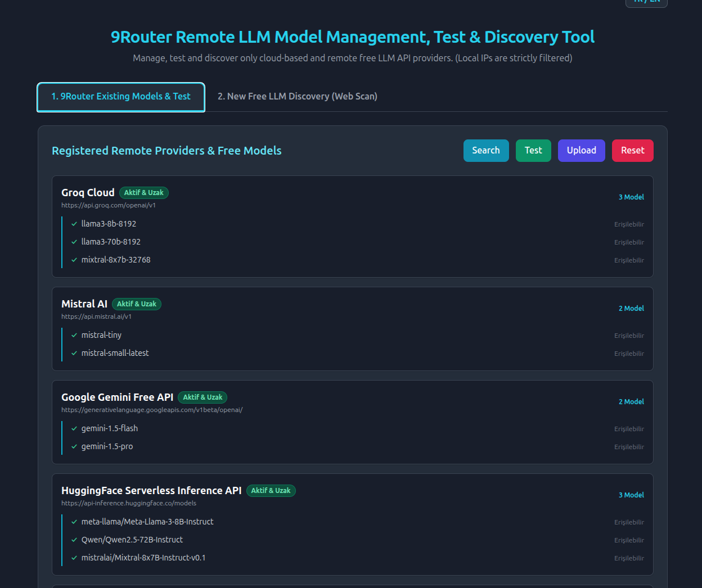
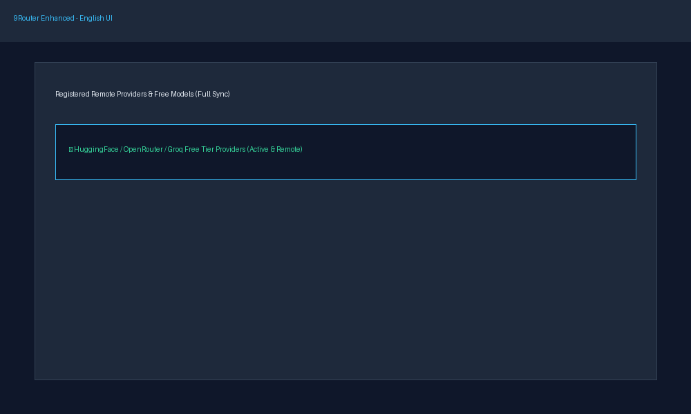

# 🚀 9Router Enhanced: Free Remote LLM Management, Testing & Discovery Tool

**The desktop application that fixes 9Router's biggest limitations and makes it much more powerful.**

> 🌟 **Most Important Feature:** Automatically finds, tests, and permanently adds **dozens of new free cloud LLM providers and models** that 9Router cannot list or discover by default, directly into the 9Router database.

---

## 📸 Screenshots

### 🖥️ Main Interface (Turkish)


### 🌐 English Support


---

## ✨ Features

- 🔍 **Deep Web Discovery:** Scans open-source platforms (HuggingFace, OpenRouter, etc.) to find new free LLMs.
- 🚫 **Security Filter:** Strictly accepts only real cloud/remote APIs. `localhost`, `127.0.0.1` and other local addresses are strictly filtered out.
- ✅ **Automated Testing:** Sends test requests to every found model to verify real accessibility, filtering out broken ones.
- 🔄 **9Router Synchronization:** Writes models into the 9Router SQLite database in the format it understands (customModels scope, global scope, providerStrategies).
- 🧠 **Smart Combo Management:** Automatically adds all newly found models to combo lists like "All Models in Order" (TumModellerSirayla).
- 🔁 **Duplicate Prevention:** Does not suggest models that are already registered.
- 🌍 **TR/EN Language Support:** Full i18n translation infrastructure allowing instant switching between Turkish and English.

---

## 🛠️ Installation

### Requirements
- Python 3.10+
- conda or virtualenv (recommended)

### Steps

```bash
# 1. Clone the repository
git clone https://github.com/tekinaltun2025/9RouterEnhanced.git
cd 9RouterEnhanced

# 2. Install dependencies
pip install -r requirements.txt

# 3. Start the application
python app.py
```

Open your browser at `http://127.0.0.1:8099`.

---

## 📦 System Service (Optional)

You can run the application in the background as a systemd user service:

```bash
# Copy the service file
cp router-tool.service ~/.config/systemd/user/

# Enable and start the service
systemctl --user daemon-reload
systemctl --user enable --now router-tool.service

# Check status
systemctl --user status router-tool.service
```

---

## 🗂️ API Endpoints

| Endpoint | Method | Description |
|----------|--------|-------------|
| `/api/models` | GET | Retrieves registered providers and models from 9Router |
| `/api/test-models` | POST | Tests accessibility of all models |
| `/api/upload` | POST | Uploads found models into 9Router SQLite database |
| `/api/reset` | POST | Restores the last saved configuration |
| `/api/scan-web` | GET | Performs deep web scan to find new providers |
| `/api/add-provider` | POST | Manually adds a specific provider to the pool |

---

## 📁 Project Structure

```
9RouterEnhanced/
├── app.py                 # FastAPI main application
├── templates/
│   └── index.html         # Jinja2 server-side UI (TR/EN)
├── requirements.txt       # Python dependencies
├── router-tool.service    # systemd user service
├── icon.svg               # Application icon
└── README.md              # This file
```

---

## 🤝 Contributing

This tool is developed for the 9Router community. Pull requests and issues are welcome.

---

## 📄 License

MIT License
