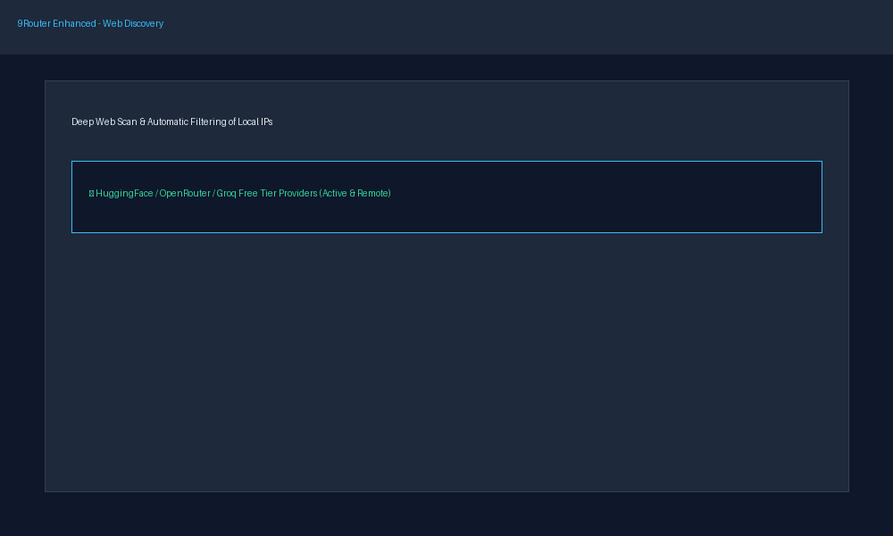
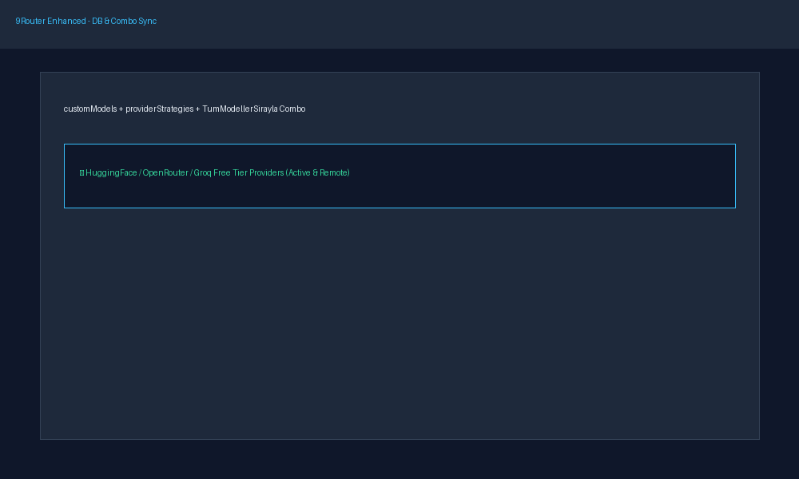

# 🚀 9Router Enhanced: Ücretsiz Uzak LLM Yönetim, Test ve Keşif Aracı

**9Router'ın en önemli eksikliklerini gideren ve onu çok daha güçlü hale getiren masaüstü uygulaması.**

> 🌟 **En Önemli Geliştirme:** 9Router'ın varsayılan olarak listelemediği veya keşfedemediği **onlarca yeni ücretsiz bulut LLM sağlayıcısını ve modelini** otomatik olarak bulur, test eder ve 9Router veritabanına kalıcı olarak ekler.

---

## 📸 Ekran Görüntüleri

### 🖥️ Ana Arayüz (Türkçe)


### 🌐 İngilizce Desteği


### 🔍 Derin Web Tarama (Keşif)


### 🗄️ 9Router Veritabanı Entegrasyonu


---

## ✨ Özellikler

- 🔍 **Derinlemesine Web Keşfi:** Açık kaynak platformları (HuggingFace, OpenRouter vb.) tarar, yeni ücretsiz LLM'leri bulur.
- 🚫 **Güvenlik Filtresi:** Yalnızca gerçek bulut/uzak API'leri kabul eder. `localhost`, `127.0.0.1` gibi yerel adresleri kesinlikle filtreler.
- ✅ **Otomatik Test:** Bulunan her modelin gerçekten erişilebilir olduğunu test eder, çalışmayanları eler.
- 🔄 **9Router Senkronizasyonu:** Modelleri 9Router'ın anladığı formatta (customModels scope, global scope, providerStrategies) veritabanına yazar.
- 🧠 **Akıllı Kombo Yönetimi:** Bulunan tüm yeni modelleri "Tüm Modeller Sırayla" gibi kombo listelerine otomatik ekler.
- 🔁 **Mükerrer Önleme:** Zaten kayıtlı olan modelleri tekrar önermez.
- 🌍 **TR/EN Dili Desteği:** Tam çeviri altyapısı ile Türkçe/İngilizce tek tıkla değiştirilebilir.

---

## 🛠️ Kurulum

### Gereksinimler
- Python 3.10+
- conda veya virtualenv (önerilen)

### Adımlar

```bash
# 1. Repoyu klonlayın
git clone https://github.com/tekinaltun2025/9RouterEnhanced.git
cd 9RouterEnhanced

# 2. Bağımlılıkları yükleyin
pip install -r requirements.txt

# 3. Uygulamayı başlatın
python app.py
```

Tarayıcınızda `http://127.0.0.1:8099` adresini açın.

---

## 📦 Sistem Servisi (Opsiyonel)

Uygulamayı arka planda sürekli çalıştırmak için systemd user servisi kullanılabilir:

```bash
# Servis dosyasını kopyalayın
cp router-tool.service ~/.config/systemd/user/

# Servisi etkinleştirin ve başlatın
systemctl --user daemon-reload
systemctl --user enable --now router-tool.service

# Durumunu kontrol edin
systemctl --user status router-tool.service
```

---

## 🗂️ API Endpoints

| Endpoint | Method | Açıklama |
|----------|--------|----------|
| `/api/models` | GET | 9Router'daki kayıtlı sağlayıcıları ve modelleri getirir |
| `/api/test-models` | POST | Tüm modellerin erişilebilirliğini test eder |
| `/api/upload` | POST | Bulunan modelleri 9Router veritabanına yükler |
| `/api/reset` | POST | Son kayıtlı konfigürasyonu geri yükler |
| `/api/scan-web` | GET | Derin web taraması yapar ve yeni sağlayıcıları bulur |
| `/api/add-provider` | POST | Belirli bir sağlayıcıyı manuel olarak ekler |

---

## 📁 Proje Yapısı

```
9RouterEnhanced/
├── app.py                 # FastAPI ana uygulama
├── templates/
│   └── index.html         # Jinja2 server-side UI (TR/EN)
├── requirements.txt       # Python bağımlılıkları
├── router-tool.service    # systemd user servisi
├── icon.svg               # Uygulama ikonu
└── README.md              # Bu dosya
```

---

## 🤝 Katkıda Bulunma

Bu araç, 9Router topluluğu için geliştirilmiştir. Pull request'ler ve issue'lar memnuniyetle karşılanır.

---

## 📄 Lisans

MIT License
